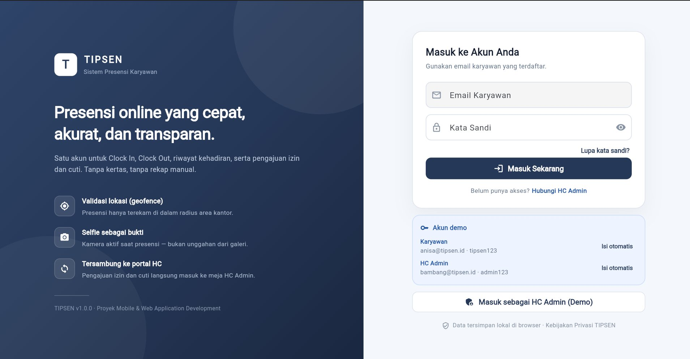
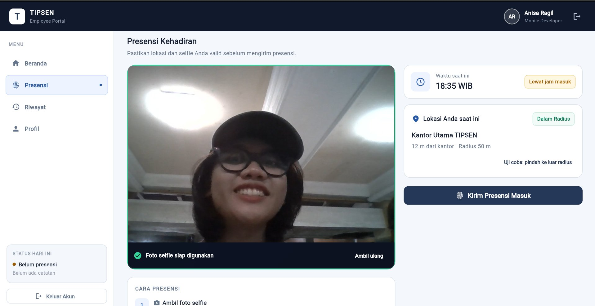
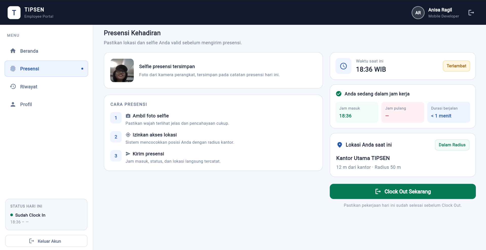
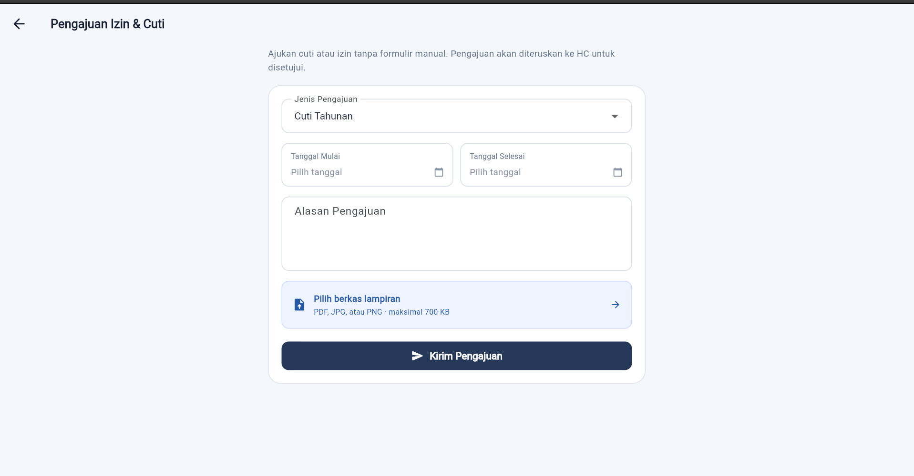
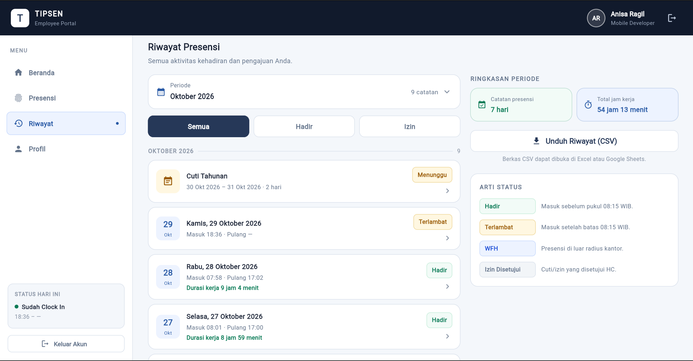
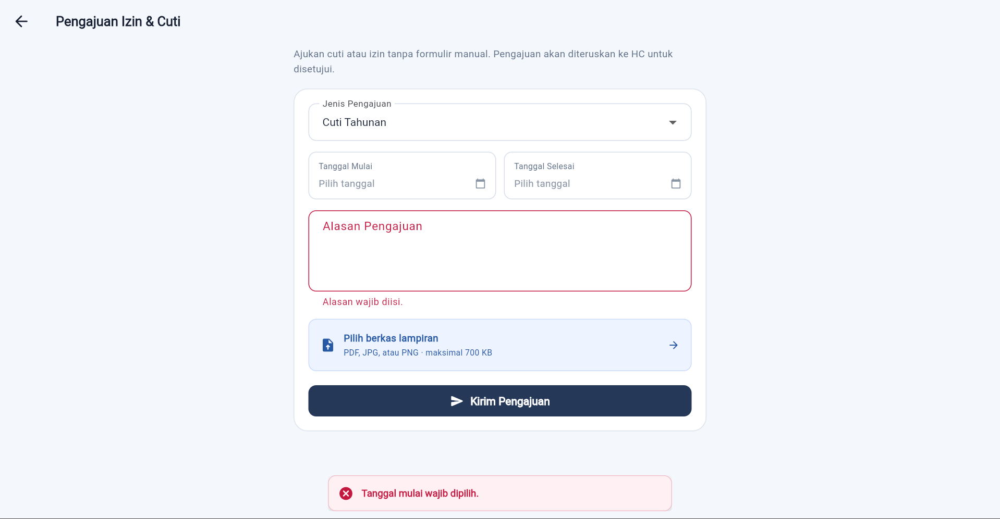
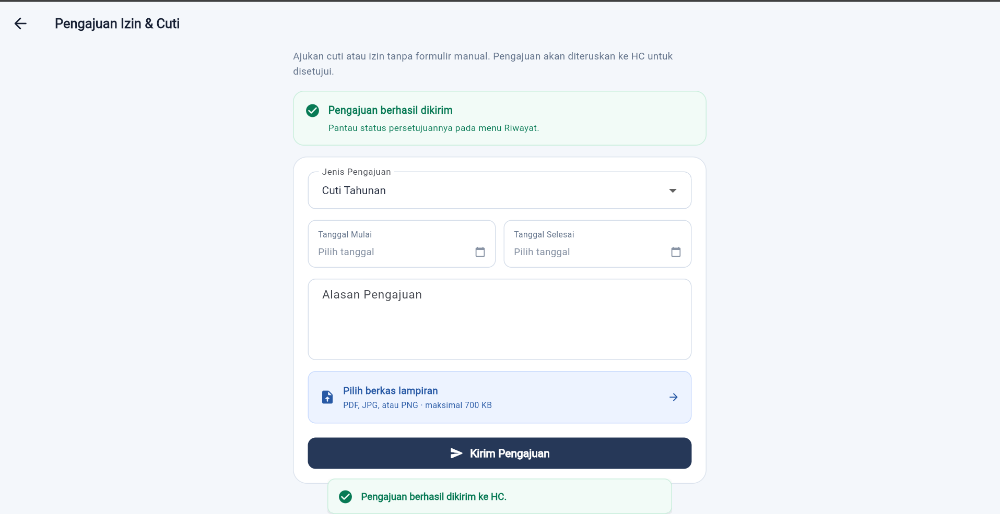

# TIPSEN — Aplikasi Presensi Online

Proyek individu mata kuliah **Mobile and Web Application Development** (Ganjil 2026/2027).
Mahasiswa: Anisa Ragil Saputri — NIM 23.01.55.0009 — Kelas A1/A2DLC.

TIPSEN adalah aplikasi presensi online karyawan berbasis **Flutter** (mobile + web) dengan
**Firebase** (Authentication email/password, Cloud Firestore, Hosting).

> **Desain & wireframe (Figma):** [TIPSEN-App-Mockups](https://www.figma.com/make/lO24y140BTgqTk4yQcynmk/TIPSEN-App-Mockups)
>
> **Proposal UTS:** [docs/PROPOSAL-UTS.md](docs/PROPOSAL-UTS.md) — problem statement, persona,
> user story, kebutuhan fungsional, user flow, sitemap, tech stack, dan rancangan database Firestore.

## Fitur inti (MVP)

- **Clock In / Clock Out** dengan validasi lokasi (GPS geofence) dan selfie
- **Riwayat presensi** karyawan
- **Pengajuan cuti/izin** secara online (Should)
- **Laporan & ekspor data** untuk admin/HC (Could)

## Teknologi

| Komponen | Fungsi | Status |
|---|---|---|
| Flutter + Dart (Material 3) | Aplikasi web (Chrome) & mobile | ✅ dipakai |
| `provider` | Manajemen state (`AppState`) | ✅ dipakai |
| `camera` + `camera_web` | Selfie presensi dari kamera perangkat | ✅ dipakai |
| `file_picker` | Unggah lampiran pengajuan (PDF/JPG/PNG) | ✅ dipakai |
| `shared_preferences` | Penyimpanan lokal (data tahan refresh) | ✅ dipakai |
| `google_fonts` (Inter) | Tipografi sesuai style guide | ✅ dipakai |
| Firebase Authentication | Login email/password | ⏸ fase berikutnya |
| Cloud Firestore | Penyimpanan data terpusat (CRUD) | ⏸ fase berikutnya |
| Firebase Hosting | Publikasi versi web | ⏸ fase berikutnya |
| GitHub | Repositori & riwayat perubahan | ✅ dipakai |

> Catatan batasan proyek: tanpa billing account, Cloud Functions, OTP telepon,
> maupun payment gateway. Versi saat ini menyimpan data di browser
> (`localStorage`) agar dapat didemokan tanpa konfigurasi akun; struktur model
> sudah ber-JSON sehingga siap dipindahkan ke Firestore.

## Akun demo

| Peran | Email | Kata sandi |
|-------|-------|------------|
| Karyawan | `anisa@tipsen.id` | `tipsen123` |
| HC Admin | `bambang@tipsen.id` | `admin123` |

## Menjalankan project

```bash
flutter pub get
flutter run -d chrome   # versi web (pengembangan)

# build rilis + pratinjau lokal
flutter build web
python -m http.server 8080 -d build/web
```

> Kamera dan lokasi hanya aktif bila halaman dibuka di **tab Chrome langsung**,
> bukan di dalam iframe pratinjau.

## Tampilan Aplikasi

### Aplikasi Karyawan

| | |
|---|---|
|  |  |
|  |  |

### Portal HC (Admin)

| |
|---|
|  |

### Form Pengajuan — Validasi dan Status

| | |
|---|---|
|  |  |

- **Beranda** — ringkasan presensi hari ini dan akses cepat.
- **Presensi** — Clock In / Clock Out dengan validasi GPS geofence dan selfie.
- **Riwayat** — daftar presensi dan pengajuan dengan filter periode.
- **Form Pengajuan** — jenis, rentang tanggal, alasan, dan lampiran.
- **Validasi** — pesan kesalahan jelas per kolom saat data tidak lengkap/salah.
- **Berhasil** — data valid tersimpan, muncul di Riwayat dan Persetujuan HC.

## Rancangan & dokumentasi

| Berkas | Isi |
|---|---|
| `PROGRES.md` | Status tiap fase, akun demo, hasil verifikasi otomatis |
| `CATATAN-PERBAIKAN.md` | Audit 38 temuan + 9 temuan baru beserta akar masalah & perbaikannya |
| `../design-figma/ANALISIS-DESAIN.md` | Analisis ekspor desain Figma Make |

User flow, sitemap, wireframe, dan style guide tersedia pada modul minggu 1–4
serta prototipe Figma "TIPSEN-App-Mockups".

## Minggu 10 — Cloud Firestore (Tambah & Tampilkan Data)

Data presensi kini tersimpan di **Cloud Firestore** dan tampil **real-time**,
sehingga bertahan setelah browser di-refresh (tekan F5 → data tetap ada).
Batas pertemuan: operasi **Create** dan **Read** saja (Update/Hapus = Minggu 11).

### Pemetaan ERD proyek → 3 collection

| Collection | Isi & field utama | Operasi Minggu 10 |
|---|---|---|
| `users/{uid}` | `uid`, `nama`, `email`, `jabatan`, `departemen`, `jadwal`, `peran`, `aktif`, `dibuatPada` (Timestamp) | **Create** otomatis saat daftar/masuk (bila belum ada), Read |
| `lokasi/{kode}` | `id`, `nama`, `alamat`, `latitude`, `longitude`, `radiusMeter`, `utama` | **Auto-seed** 4 lokasi via `WriteBatch` saat kosong, **Read real-time** |
| `presensi/{uid_tanggal}` | `uid`, `tanggal` (`yyyy-MM-dd`), `status`, `clockIn`, `clockOut`, `lokasiNama`, `jarakMeter`, `dalamRadius`, `selfie`, `keterangan`, `foto` (base64 ≤ 200 KB), `dibuatPada` | **Create** saat Clock In (ditolak bila sudah presensi hari yang sama), **Read real-time** per pengguna |

Catatan desain:

- **Doc ID presensi = `uid_tanggal`** — satu dokumen per pengguna per hari; cara
  termurah mencegah presensi ganda (dicek lagi di layanan sebelum `.set()`).
- **Denormalisasi** — `lokasiNama` ikut disimpan di dokumen `presensi` karena
  Firestore tidak mendukung JOIN; daftar riwayat cukup satu kali baca.
- **Anti composite index** — query real-time memakai satu `.where('uid', ...)`
  dan pengurutan terbaru dilakukan di sisi Dart (`.sort`), bukan `.orderBy()`.
- **Clock Out** memperbarui `clockOut` pada dokumen hari yang sama — satu-satunya
  penulisan di luar Create karena alur presensi TIPSEN menuntutnya; materi Update
  (Edit/Hapus) disentuh awal di sini dan diperdalam Minggu 11.
- **Lapisan layanan terpisah** — `lib/services/layanan_firestore.dart` berisi
  kontrak `LayananTipsen`, `LayananFirestore` (produksi), dan `LayananMemori`
  (widget test / fallback tanpa Firebase), sehingga `flutter test` tetap lulus.

### Perbaikan selama pengujian

- **Sapaan memakai profil akun sebelumnya** — login dengan akun lain
  (mis. `febrian@tipsen.id`) sempat menampilkan nama akun sebelumnya karena
  nama lengkap belum dibaca balik dari Firestore. Perbaikan: saat berganti
  akun profil dibangun ulang dari email, lalu profil dibaca dari
  `users/{uid}` (`bacaPengguna`) dan diterapkan ke tampilan.

### Aktivasi Firestore & Security Rules (langkah Console)

1. Buka project **tipsen-app** di console.firebase.google.com → **Build > Firestore Database**.
2. **Create database** → edisi Standard (gratis di paket Spark) → lokasi
   `asia-southeast2` (Jakarta) → **Start in production mode** → Create.
3. Tab **Rules** → salin isi `firestore.rules` di root project → **Publish**.
   Intinya: `allow read, write: if request.auth != null;` (jangan Test Mode `if true;`).

### Tabel Uji Cloud Firestore (≥ 5 kasus)

| # | Kasus uji | Langkah | Hasil yang diharapkan | Hasil nyata |
|---|-----------|---------|----------------------|-------------|
| 1 | Tambah data valid | Login karyawan → Presensi → Clock In (lokasi + selfie) | Dokumen baru muncul di collection `presensi` & daftar Riwayat | ✅ [bukti](docs/firestore-presensi.png) |
| 2 | Tolak presensi ganda | Mencoba Clock In dua kali pada hari yang sama (logout → login → Presensi) | Langkah tetap "sudah Clock In"; layanan menolak dokumen kedua | ✅ tombol Clock In tidak muncul lagi walau logout-login/refresh |
| 3 | Bertahan saat refresh | Setelah Clock In tekan **F5** di Chrome | Sapaan nama, daftar lokasi, dan riwayat presensi tetap tampil dari cloud | ✅ [bukti](docs/firestore-refresh.png) |
| 4 | Isolasi antar akun | Keluar → masuk akun lain | Presensi akun pertama tidak muncul (stream difilter `uid`) | ✅ [bukti](docs/firestore-isolasi.png) |
| 5 | Security Rules tanpa login | Rules sementara diubah `if false` → refresh → dikembalikan | Firebase mengembalikan `permission-denied`; data lokasi kembali normal setelah rules diperbaiki | ✅ [ditolak](docs/firestore-rules-ditolak.png) · [pulih](docs/firestore-rules-pulih.png) |
| 6 | Auto-seed master lokasi | Login pertama kali, cek Console | Collection `lokasi` terisi 4 dokumen sekali saja (tidak dobel) | ✅ [bukti](docs/firestore-lokasi.png) |
| 7 | Clock Out tersinkron | Clock Out lalu cek dokumen `presensi` hari ini | Field `clockOut` terisi; durasi muncul di Riwayat | ✅ [bukti](docs/firestore-presensi.png) |

Verifikasi Console: screenshot isi ketiga collection dilampirkan pada laporan —
[`users`](docs/firestore-users.png) · [`lokasi`](docs/firestore-lokasi.png) ·
[`presensi`](docs/firestore-presensi.png).

## Minggu 11 — CRUD Lengkap: Ubah & Batalkan Pengajuan

Pengajuan izin/cuti kini tersimpan di collection **`pengajuan`** (Firestore) dengan
field audit: `idPengguna` (pemilik, tidak boleh berubah), `diajukanPada`
(`dibuatPada`), `diubahPada`, dan `status`. Siklus CRUD lengkap:

- **Create** — `kirimPengajuan()` → `tambahPengajuan()` (doc baru, status `menunggu`).
- **Read** — real-time: karyawan menerima pengajuannya sendiri, HC menerima semua.
- **Update** — tombol **Ubah** di Detail Pengajuan membuka formulir mode ubah
  (satu form, dua mode via `pengajuanAwal`); ditulis dengan `update()` (bukan
  `set()`) sehingga field audit tetap utuh.
- **Delete** — tombol **Batalkan** selalu lewat dialog konfirmasi
  (`await showDialog<bool>`), baru `delete()`.

Aturan bisnis "hanya pemilik + hanya status Menunggu" diterapkan dua lapis:
di kode (`pastikanBolehDiubah()` di lapisan layanan) dan di
[`firestore.rules`](firestore.rules) (aturan kepemilikan + peran HC untuk
keputusan Setujui/Tolak). Cek tumpang tindih periode memakai
`abaikanIdPengajuan` agar dokumen yang sedang diubah tidak dianggap bentrok
dengan dirinya sendiri.

### Security Rules (Minggu 11) — langkah Console

1. Buka **Console Firebase → Firestore Database → Rules**.
2. Salin ulang isi `firestore.rules` di root project → **Publish**.
   Isi baru: `users` write hanya pemilik uid; `presensi` create/update hanya
   pemilik; `pengajuan` create/update/delete hanya pemilik + status `menunggu`,
   kecuali update keputusan oleh peran `admin` (HC).
3. Tanpa Publish, operasi baru akan terus memakai Rules lama Minggu 10.

### Tabel Uji CRUD (≥ 6 kasus)

| # | Kasus uji | Langkah | Hasil yang diharapkan | Hasil nyata |
|---|-----------|---------|----------------------|-------------|
| 1 | Ubah data valid | Detail Pengajuan (status Menunggu) → Ubah → ganti alasan/tanggal → Simpan Perubahan | Dokumen berubah; `diajukanPada` & `idPengguna` tetap; `diubahPada` terisi | ⏳ isi setelah menguji di Chrome |
| 2 | Ubah jadi periode tumpang tindih | Ubah pengajuan ke periode yang sama dengan pengajuan lain milik sendiri | Ditolak dengan pesan periode bertumpuk; data lama utuh | ⏳ |
| 3 | Ubah/batalkan status terkunci | Coba aksi pada pengajuan berstatus Disetujui/Ditolak | Menu Aksi tidak tampil (`bisaDiubah`); bila dipaksa (API), ditolak Rules | ⏳ |
| 4 | Batalkan dengan konfirmasi | Detail Pengajuan → Batalkan → dialog → "Ya, Batalkan" | Dialog muncul menyebut data; setelah setuju dokumen hilang dari Console | ⏳ |
| 5 | Batalkan lalu tekan Batal | Detail Pengajuan → Batalkan → tekan "Batal" | Dialog tertutup; data tetap ada, tidak ada perubahan | ⏳ |
| 6 | Aksi pada pengajuan akun lain | Masuk akun kedua, coba ubah/batalkan pengajuan akun pertama via API | Ditolak (`permission-denied` / pesan bukan pemilik) | ⏳ |
| 7 | Keputusan HC tersinkron | HC menyetujui pengajuan di Portal HC | Status berubah di aplikasi karyawan real-time (stream `pengajuan`) | ⏳ |

> Kolom "Hasil nyata" diisi setelah pengujian di Chrome beserta screenshot
> Console (collection `pengajuan` sebelum/sesudah ubah & batal).
