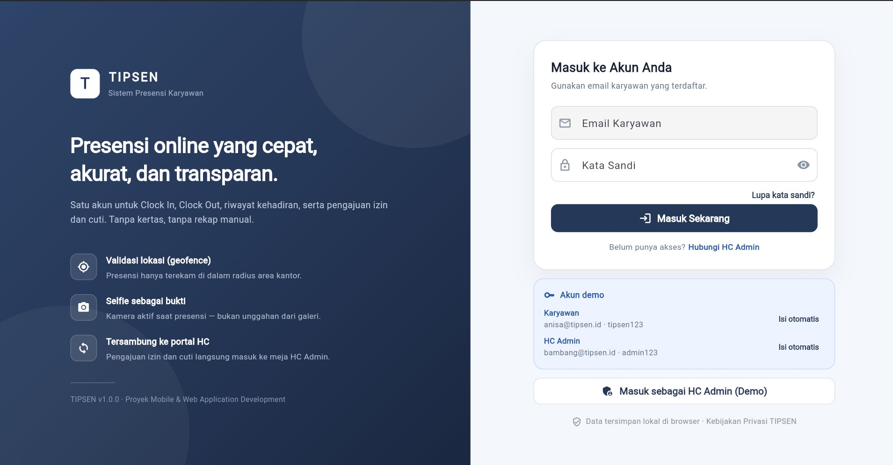
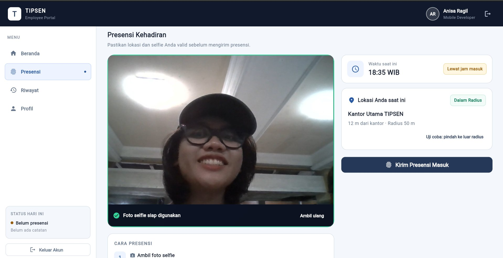
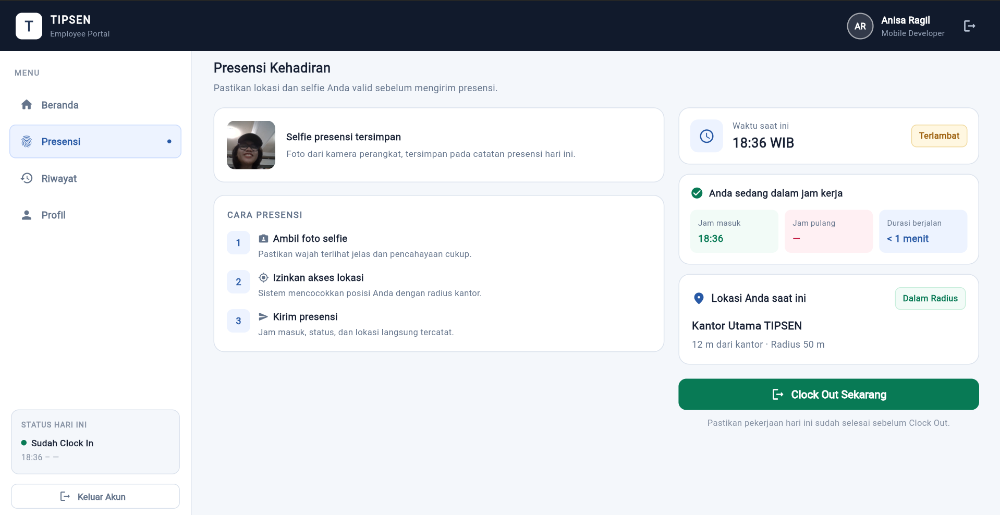
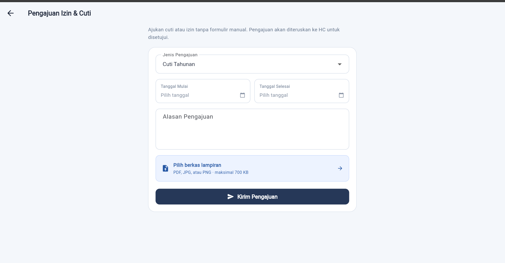
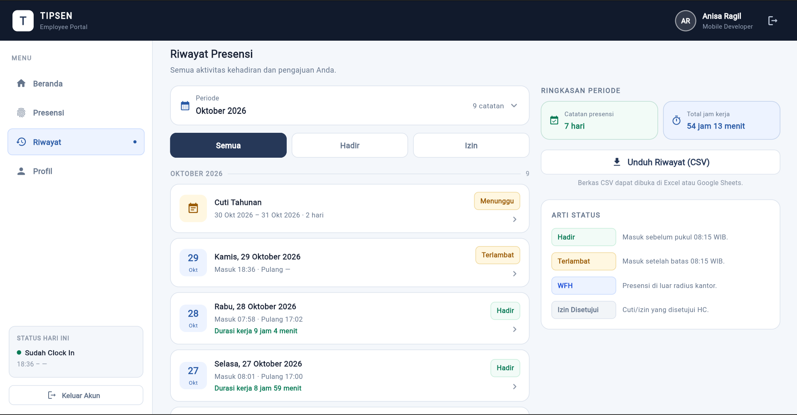
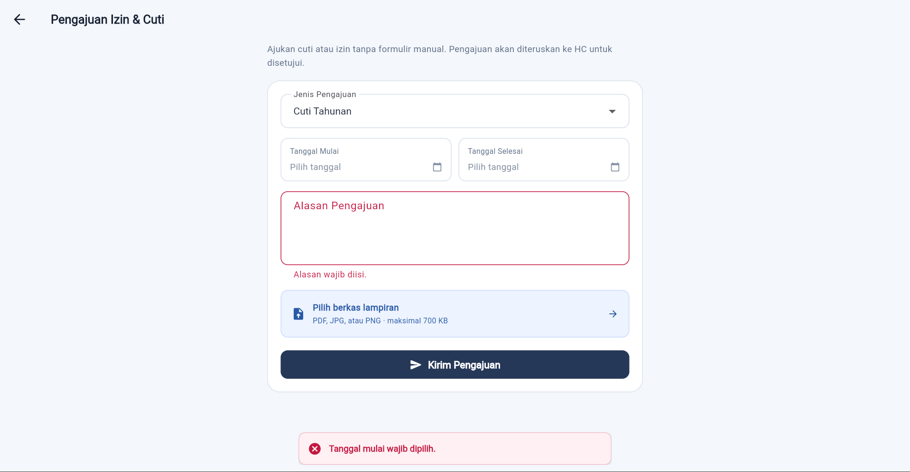
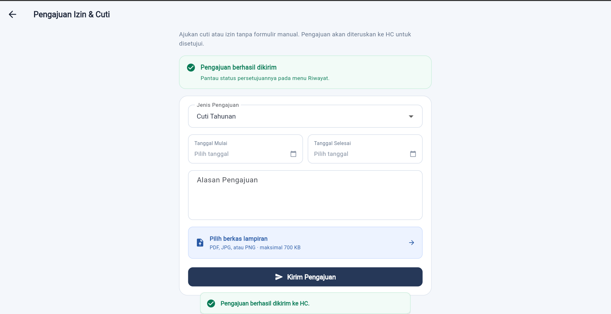

# TIPSEN — Aplikasi Presensi Online

Proyek individu mata kuliah **Mobile and Web Application Development** (Ganjil 2026/2027).
Mahasiswa: Anisa Ragil Saputri — NIM 23.01.55.0009 — Kelas A1/A2DLC.

TIPSEN adalah aplikasi presensi online karyawan berbasis **Flutter** (mobile + web) dengan
**Firebase** (Authentication email/password, Cloud Firestore, Hosting).

## Fitur inti (MVP)

- **Clock In / Clock Out** dengan validasi lokasi (GPS geofence) dan selfie
- **Riwayat presensi** karyawan
- **Pengajuan cuti/izin** secara online (Should)
- **Laporan & ekspor data** untuk admin/HC (Could)

## Teknologi

| Komponen | Fungsi | Status |
|---|---|---|
| Flutter + Dart (Material 3) | Aplikasi web (Chrome) & mobile | ✅ dipakai |
| `provider` | Manajemen state (`AppState`) | ✅ dipakai |
| `camera` + `camera_web` | Selfie presensi dari kamera perangkat | ✅ dipakai |
| `file_picker` | Unggah lampiran pengajuan (PDF/JPG/PNG) | ✅ dipakai |
| `shared_preferences` | Penyimpanan lokal (data tahan refresh) | ✅ dipakai |
| `google_fonts` (Inter) | Tipografi sesuai style guide | ✅ dipakai |
| Firebase Authentication | Login email/password | ⏸ fase berikutnya |
| Cloud Firestore | Penyimpanan data terpusat (CRUD) | ⏸ fase berikutnya |
| Firebase Hosting | Publikasi versi web | ⏸ fase berikutnya |
| GitHub | Repositori & riwayat perubahan | ✅ dipakai |

> Catatan batasan proyek: tanpa billing account, Cloud Functions, OTP telepon,
> maupun payment gateway. Versi saat ini menyimpan data di browser
> (`localStorage`) agar dapat didemokan tanpa konfigurasi akun; struktur model
> sudah ber-JSON sehingga siap dipindahkan ke Firestore.

## Akun demo

| Peran | Email | Kata sandi |
|-------|-------|------------|
| Karyawan | `anisa@tipsen.id` | `tipsen123` |
| HC Admin | `bambang@tipsen.id` | `admin123` |

## Menjalankan project

```bash
flutter pub get
flutter run -d chrome   # versi web (pengembangan)

# build rilis + pratinjau lokal
flutter build web
python -m http.server 8080 -d build/web
```

> Kamera dan lokasi hanya aktif bila halaman dibuka di **tab Chrome langsung**,
> bukan di dalam iframe pratinjau.

## Tampilan Aplikasi

### Aplikasi Karyawan

| | |
|---|---|
|  |  |
|  |  |

### Portal HC (Admin)

| |
|---|
|  |

### Form Pengajuan — Validasi dan Status

| | |
|---|---|
|  |  |

- **Beranda** — ringkasan presensi hari ini dan akses cepat.
- **Presensi** — Clock In / Clock Out dengan validasi GPS geofence dan selfie.
- **Riwayat** — daftar presensi dan pengajuan dengan filter periode.
- **Form Pengajuan** — jenis, rentang tanggal, alasan, dan lampiran.
- **Validasi** — pesan kesalahan jelas per kolom saat data tidak lengkap/salah.
- **Berhasil** — data valid tersimpan, muncul di Riwayat dan Persetujuan HC.

## Rancangan & dokumentasi

| Berkas | Isi |
|---|---|
| `PROGRES.md` | Status tiap fase, akun demo, hasil verifikasi otomatis |
| `CATATAN-PERBAIKAN.md` | Audit 38 temuan + 9 temuan baru beserta akar masalah & perbaikannya |
| `../design-figma/ANALISIS-DESAIN.md` | Analisis ekspor desain Figma Make |

User flow, sitemap, wireframe, dan style guide tersedia pada modul minggu 1–4
serta prototipe Figma "TIPSEN-App-Mockups".
